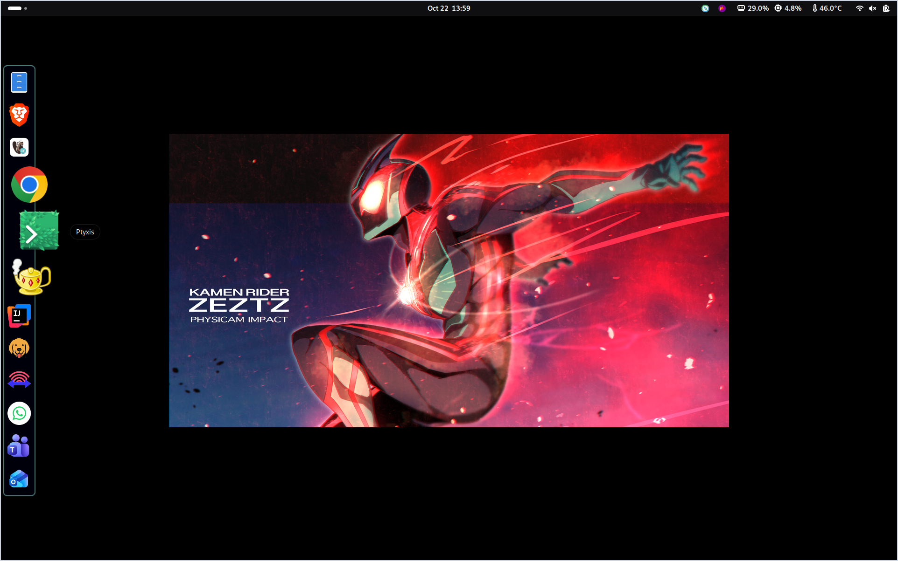

# Dash2Dock Animated

**Based on [Dash2Dock Animated by icedman](https://github.com/icedman/dash2dock-lite).** The original project, design, and foundation are icedman's work.

This personal fork is updated around my preferred dock configuration, saved in [my-custom.dconf](my-custom.dconf), and maintained on `main`. Its changes have only been tested on my own machine, described [below](#tested-setup).

If you enjoy this cool project, you can **[support him on Buy Me a Coffee](https://www.buymeacoffee.com/icedman)**.

[](https://www.buymeacoffee.com/icedman)



[Install](#installation) · [Update](#updating) · [Restore my settings](#restore-my-custom-settings) · [Customize](#customization) · [Troubleshoot](#troubleshooting-and-bug-reports)

## Overview

An animated GNOME desktop dock with magnification, autohide, window previews, and all four screen-edge positions. Current extension version: **109**. See the [changelog](CHANGELOG.md) for release details.

* Animated icons, running indicators, notification badges, and favorite reordering
* Multi-monitor support, autohide/intellihide, and panel mode
* Window thumbnails, single-window toggling, and scrollwheel window selection
* Optional clock, calendar, Trash, mounted-device icons, and a Downloads fan
* Themes, custom icons/CSS, top-panel styling, and Blur My Shell integration

| Package | Declared GNOME Shell targets | Build command |
| --- | --- | --- |
| Modern | 46, 47, 48, 49, 50, 51 | `make publish` |
| Legacy | 42, 43, 44 | `make publish-g44` |

Declared targets still require verification in the corresponding desktop session. Other Shell versions are not covered. The Show Apps button's front-position option works on horizontal docks only.

### Tested setup

This is the maintainer's local setup, recorded on October 22, 2026. Testing of this fork is limited to this machine; the other GNOME targets above are build declarations, not verified desktop results.

| Component | Version or hardware |
| --- | --- |
| Linux distribution | Debian GNU/Linux 13.7 (trixie) |
| Kernel | `7.1.13+deb13-amd64` |
| Desktop | GNOME Shell 48.7 |
| Session | Wayland |
| Architecture | `x86_64` |
| CPU | Intel Core Ultra 5 125U |

## Dock behavior

| Action | Result |
| --- | --- |
| Click an app with one window | Focus or restore it. Click again while focused to minimize; clicking from the overview returns to the window. |
| Click an inactive app with several windows | Focus its most recent eligible unminimized window, or restore one window if all are minimized. |
| Click the active app with several windows | Open its thumbnail chooser. Select a preview to activate only that window. |
| Browse previews | The source icon stays zoomed. Move to another icon or away, click outside, press Escape, or click the source again to dismiss without selecting. Another icon responds to the first click. |
| Scroll over an app | Cycle through its windows, restoring only the selected window. Hold Ctrl to stay on the current workspace. |
| Ctrl-click or middle-click | Use GNOME's native new-window action. |
| Right-click | Open native app actions toward the desktop: right of a left dock, left of a right dock, below a top dock, or above a bottom dock. |

Click and scroll selection use the configured monitor filter; previews and the native app menu show the app-wide window list. Opening previews preserves keyboard focus and leaves minimized siblings minimized. Unavailable window surfaces show the app icon, and closing previews releases their resources.

This fork also restores windows after Show Desktop, keeps magnified icons clickable beyond the dock frame, and prevents the old dock footprint from revealing an autohidden dock before the pointer reaches the edge. These window actions are this fork's GNOME dock policy.

## Installation

Requirements: Git, Make, zip, GLib schema tools, and GNOME's `gnome-extensions` CLI. Run installation commands in your normal desktop session.

Clone this fork:

```sh
git clone --branch main https://github.com/m-arson/dash2dock-lite.git
cd dash2dock-lite
```

### GNOME Shell 46-51

Build the modern archive:

```sh
make publish
```

### GNOME Shell 42-44

Legacy conversion also requires Python 3. Build the legacy archive:

```sh
make publish-g44
```

Both targets write `dash2dock-lite@icedman.github.com.zip`. They build a local archive without installing or uploading it.

### Install and enable

For a **fresh installation**, install the archive you just built:

```sh
gnome-extensions install dash2dock-lite@icedman.github.com.zip
```

Log out and back in so GNOME Shell discovers the extension. Enable it in the Extensions app or run:

```sh
gnome-extensions enable dash2dock-lite@icedman.github.com
```

To reuse the saved personal setup, follow [Restore My Custom Settings](#restore-my-custom-settings). For an existing installation, use the update steps below.

The [GNOME Extensions listing](https://extensions.gnome.org/extension/4994/dash2dock-lite/) and [Arch AUR package](https://aur.archlinux.org/packages/gnome-shell-extension-dash2dock-lite) distribute upstream versions and may not include this fork's changes.

## Updating

Build the appropriate archive from the updated source, then run the update helper. It requires Python 3.9 or newer, `dconf`, and `gnome-extensions`:

```sh
python3 tools/apply_update.py dash2dock-lite@icedman.github.com.zip \
  --backup-root "$HOME/.local/share/dash2dock-lite-backups"
```

The helper backs up installed files, extension preferences, custom configuration, and relevant Shell settings. It validates the archive and verifies files and preserved preferences after installation, restoring the previous installation and preferences if the update fails. It prints the backup location and records the result in `manifest.json` there.

An existing extension directory must not be a symlink, and its settings schema must match the archive. Schema changes require a reviewed migration. Log out and back in after a successful update to load the new code.

## Restore My Custom Settings

[my-custom.dconf](my-custom.dconf) saves this fork maintainer's dock configuration: **94 preferences**, including their current default values. It covers appearance, dock position, autohide, animations, window behavior, and optional icons. Runtime messages and the detected monitor count are excluded.

After a fresh installation, copy `my-custom.dconf` to the new computer and run this command from the folder containing it:

```sh
dconf load /org/gnome/shell/extensions/dash2dock-lite/ < my-custom.dconf
```

Then log out and back in. The file is included in both extension archives and is applied only when you run the command. It retains `/home/arson/Downloads` as `downloads-path`; adjust that value if restoring under a different username.

This full snapshot is separate from the appearance-only JSON theme export below.

## Customization

### Themes

Use **Style > Themes > Export** in preferences to export appearance settings. The window reports the output path, `/tmp/<username>-theme.json`.

Edit the JSON, save it under `~/.config/d2da/themes/` with a `.json` extension, and reopen preferences to load it. Bundled presets live under `<extension_path>/themes/`.

### Custom icons

Put SVG files in `~/.config/d2da/icons/` and create `~/.config/d2da/icons.json`:

```json
{
  "icons": {
    "view-app-grid-symbolic": "icons/show-apps-icon.svg",
    "user-trash": "icons/my-own-trash.svg",
    "user-trash-full": "trash-full"
  },
  "apps": {
    "spotify_spotify": "icons/spotify.svg"
  }
}
```

Paths are relative to `~/.config/d2da/`. Values can also name icons from your installed icon theme, such as `trash-full`. Application keys use the desktop-file ID with the `.desktop` suffix removed. Disable and re-enable the extension after changing custom icons.

### Configuration

Create `~/.config/d2da/config.json`:

```json
{
  "file-explorer": "nemo",
  "icon-size": 24
}
```

* `file-explorer` sets a preferred folder-opening command. Without an override, the extension tries `nautilus`, `xdg-open`, then `gio open`.
* `icon-size` overrides the preference with a positive numeric value.

Disable and re-enable the extension to reload this file.

### Custom CSS

Create `~/.config/d2da/style.css`, then disable and re-enable the extension. Use GNOME Shell's Looking Glass inspector to find actor names and style classes.

### Background blur and integrations

For dock background blur, install and enable **Blur My Shell**, enable its Dash to Dock integration, and enable this dock's blurred-background preference. Both older geometry hooks and newer signal-driven dock surfaces are supported. ImageMagick is not required.

Compiz Magic Lamp Animation is also supported when installed.

## Development

Work on `main`. Plain `make` or `make build` compiles schemas without installing anything. `make install` builds and installs the modern archive through the official CLI; `make g44` does the same for the legacy archive. Use the update helper when you need its backups and preference verification.

Automated checks require Node.js 18 or newer, GJS, Python 3.9 or newer, Make, GLib schema tools, zip, and unzip:

```sh
npm test
npm run check
glib-compile-schemas --strict --dry-run schemas
```

| Guide | Contents |
| --- | --- |
| [HACKING.md](HACKING.md) | Build commands, repository layout, and development workflow |
| [DESIGN.md](DESIGN.md) | Modules, ownership, and lifecycle contracts |
| [tests/README.md](tests/README.md) | Regression coverage and focused test commands |
| [CHECKLIST.md](CHECKLIST.md) | Desktop release verification |

Automated checks cover activation, input, lifecycle cleanup, settings, packaging, and upgrade rollback. Live input, rendering, Shell compatibility, CPU use, and RAM use require a GNOME desktop session.

## Troubleshooting and bug reports

See [ERRORS.md](ERRORS.md) for diagnostics. Report fork-specific problems in [this fork's issue tracker](https://github.com/m-arson/dash2dock-lite/issues), including:

* Distribution, GNOME Shell version, and Wayland/X11 session type
* Extension version, dock position, display scaling, and relevant settings
* Steps to reproduce and screenshots when useful
* Other enabled extensions, especially integrations

Watch the Shell journal while reproducing the problem:

```sh
journalctl /usr/bin/gnome-shell -f -o cat
```

For extension conflicts, repeat the steps with other extensions disabled. For performance reports, compare idle, stationary hover, and repeated interaction under the same conditions. Monitor the Shell process with `top -d 0.5` and record CPU and memory use.

## Contributors

**icedman** is the original author. **[m-arson](https://github.com/m-arson)** maintains this personal fork and supplies its configuration and desktop testing. **OpenAI Codex**, an AI coding assistant, assisted with implementation, review, tests, and documentation.

See [CONTRIBUTORS.md](CONTRIBUTORS.md) for the attribution details. The original author credit remains unchanged in the project metadata.

## License and Attribution

Originally authored by **icedman**. This fork retains the original project's attribution, license notices, and third-party adaptation credits. Historical upstream screenshots remain in `screenshots/`; the main image above shows this fork on a user's desktop.

Distributed under the **GPL 3.0 License**; see [LICENSE](LICENSE). Visit [icedman's original project](https://github.com/icedman/dash2dock-lite) and **[support him on Buy Me a Coffee](https://www.buymeacoffee.com/icedman)**.
